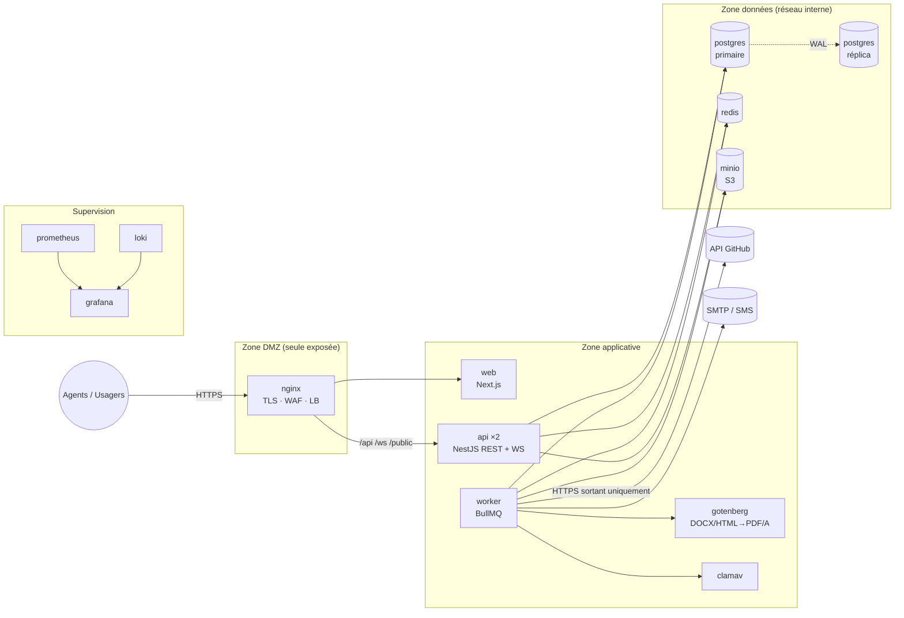
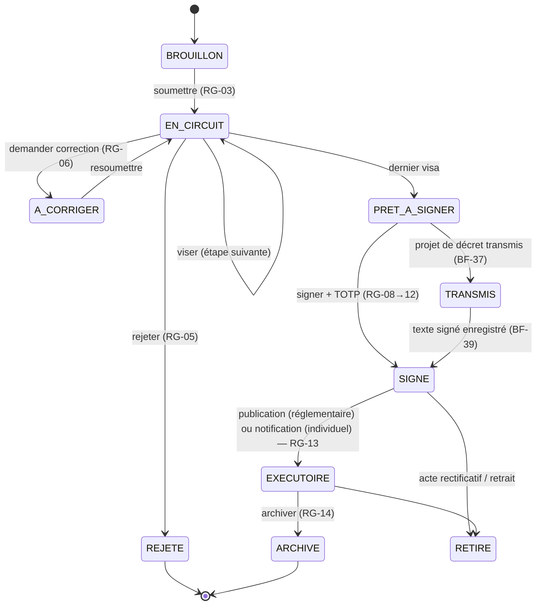

# Architecture EACT — vue d'ensemble

Cas d'étude : **Ministère de l'Enseignement Supérieur (MINESUP)**, hébergement sur l'infrastructure
de la Division des Systèmes d'Information (CT-08).

> Résumé exécutable du cahier des charges (Partie III & V). Les décisions sont tracées dans
> [`docs/adr/`](adr/).

## 1. Style retenu

**Application web 3-tiers** :

1. **Présentation** — Next.js (React, TypeScript) organisé en **MVVM**
2. **Métier** — NestJS en **monolithe modulaire multicouches** (contrôleur → service → dépôt)
3. **Données** — PostgreSQL 16 **référentiel** (centré données)

Complété par :

- **Invocation implicite** : bus d'événements interne (`acte.soumis`, `acte.vise`, `acte.signe`…)
  écouté par Audit, Notifications, Relances → le cœur métier ignore ses observateurs.
- **Tubes et filtres** : pipeline asynchrone des pièces (type → antivirus → PDF/A → empreinte → stockage).
- **Messages asynchrones** : BullMQ sur Redis pour tout ce qui est lent ou externe (PDF, GitHub, e-mail, SMS).

Microservices écartés en V1 (équipe de 7, 12 semaines) mais **préparés** : chaque module
n'expose qu'une interface (`IActes`, `IParapheur`…) et communique par événements → extractible.

## 2. Vue de déploiement (conteneurs)



### Services Docker Compose

| Service | Image | Réseau(x) | Rôle | Profil |
|---|---|---|---|---|
| `nginx` | nginx:1.27-alpine | dmz, app | Point d'entrée unique (CT-12) | défaut |
| `web` | build `apps/web` | app | Frontend Next.js (SSR pages publiques) | défaut |
| `api` | build `apps/api` | app, data | API REST `/v1`, WebSocket, Swagger | défaut |
| `worker` | build `apps/api` (cmd worker) | app, data, egress | Files BullMQ : PDF/A, antivirus, GitHub, notifs, relances | défaut |
| `postgres` | postgres:16-alpine | data | Référentiel | défaut |
| `redis` | redis:7-alpine | data | Files, cache, adaptateur Socket.IO, verrous de tâches | défaut |
| `minio` + `minio-init` | minio/minio | data | Stockage objet PDF/A et pièces (chiffré) | défaut |
| `gotenberg` | gotenberg/gotenberg:8 | app | Conversion PDF/A-2b | défaut |
| `clamav` | clamav/clamav:1.4 | app | Antivirus (RG-24) | défaut |
| `mailpit` | axllent/mailpit | app | Faux SMTP de dev (boîte web) | `dev` |
| `prometheus`, `grafana`, `loki`, `alloy` | — | obs | Supervision ENF-03 | `obs` |
| `postgres-replica` | postgres:16-alpine | data | Redondance passive (WAL) | prod |
| `backup` | postgres:16-alpine | data | `pg_dump` quotidien + WAL (3-2-1) | prod |

Lancement : `docker compose up -d` (socle) · `--profile dev` (mailpit) · `--profile obs` (supervision) ·
prod : `docker compose -f docker-compose.yml -f docker-compose.prod.yml up -d`.

## 3. Vue d'implémentation — monorepo

```
eact/
├── apps/
│   ├── api/                 NestJS (monolithe modulaire)
│   │   ├── prisma/          schema.prisma, migrations, seed
│   │   └── src/
│   │       ├── main.ts      entrée HTTP (api)
│   │       ├── worker.ts    entrée worker (BullMQ)
│   │       ├── common/      événements, idempotence, sécurité, erreurs
│   │       ├── infrastructure/  adaptateurs : prisma, stockage S3, gotenberg, clamav, github, smtp
│   │       └── modules/     m01-auth … m15-admin (1 module = 1 interface)
│   └── web/                 Next.js (MVVM)
│       └── src/
│           ├── app/         routes (App Router) : (agent)/…, verifier/[code]
│           ├── features/    1 dossier par écran : model/ view-model/ view/
│           ├── components/ui/   shadcn/ui
│           └── i18n/        fr.json, en.json
├── packages/shared/         types et règles partagés (statuts, transitions, schémas Zod)
├── infra/                   nginx, postgres, prometheus, grafana, loki, alloy
├── docs/                    architecture, ADR, design system, backlog
└── docker-compose*.yml
```

Règle de dépendance : `controller → service → repository (Prisma)` ; un module n'importe
**jamais** le dépôt d'un autre module, seulement son interface ou ses événements.

### Modules serveur ↔ cahier des charges

| Dossier | Module CDC | Interface fournie | Priorité |
|---|---|---|---|
| `m01-auth` | M01 | IAuthentification | P0 |
| `m02-organisation` | M02 | IUtilisateurs, IStructures, IDelegations | P0 |
| `m03-courrier` | M03 | ICourrier | P2 |
| `m04-actes` | M04 | IActes | P0 |
| `m05-circuit` | M05 | IParapheur | P0 |
| `m06-signature` | M06 | ISignature | P0 |
| `m07-diffusion` | M07 Diffusion et publication | IDiffusion | P2 |
| `m08-recherche` | M08 | IRecherche | P1 |
| `m09-archivage` | M09 | IArchives | P1 |
| `m10-audit` | M10 | IAudit | P0 |
| `m11-tableau-de-bord` | M11 | IIndicateurs | P2 |
| `m12-notifications` | M12 | INotifier | P2 |
| `m13-verification` | M13 | IVerification | P0 (BF-55/56) |
| `m14-github` | M14 | IDepotGabarits, IAnomalies | P0 (BF-59) / P1 |
| `m15-admin` | M15 | IParametres | P0 / P1 |
| `documents` (transverse) | §13.1 | IDocuments (pipeline) | P0 |

## 4. Vue comportementale — cycle de vie d'un acte



Les transitions sont codées **une seule fois** dans `packages/shared/src/acte-statut.ts`
et appliquées côté serveur ; le frontend s'en sert pour afficher/masquer les boutons.

## 5. Points « systèmes répartis » (CDC §16) — où c'est dans le code

| Problème | Mécanisme | Emplacement |
|---|---|---|
| Numéro unique sans trou (exclusion mutuelle) | `SELECT … FOR UPDATE` sur `compteur_numerotation` dans la transaction de signature | `m06-signature` |
| Signature rejouée (exactement une fois) | En-tête `Idempotency-Key` + table `cle_idempotence` | `common/idempotency` |
| Deux viseurs simultanés | Verrou optimiste `acte.version` → 409 | `m05-circuit` |
| Tâches planifiées sur 2 instances | Jobs répétés BullMQ (verrou Redis) | `worker.ts` |
| Journal infalsifiable | Chaînage SHA-256 + trigger anti UPDATE/DELETE | `m10-audit`, migration SQL |
| GitHub en panne | File `github`, backoff 1→16 s, disjoncteur 5 échecs / 60 s, cache gabarits | `infrastructure/github` |
| Horloges | Dates fixées par `now()` PostgreSQL (NTP serveur) | Prisma `@default(now())` |
| Serveur sans état | JWT court + refresh httpOnly → n'importe quelle instance répond | `m01-auth` |
